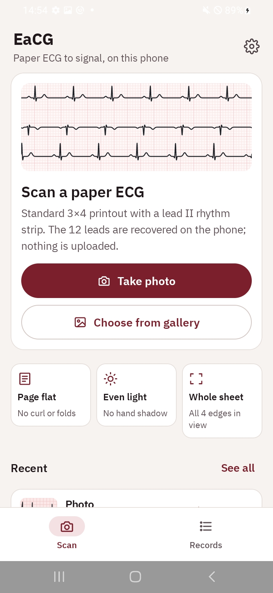
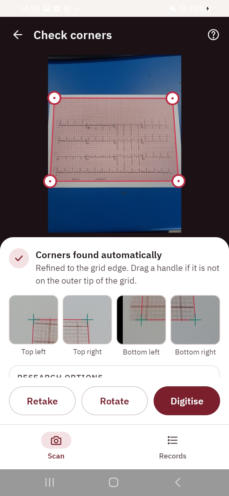
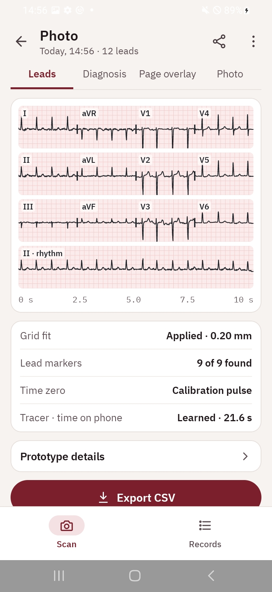
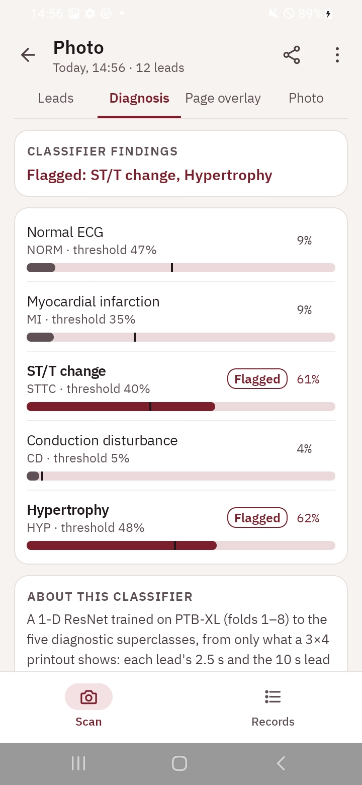

# EaCG — paper ECG to signal, on the phone

Final-year engineering thesis project (University of Cape Town, EEE4022). An
Android app that photographs a standard 3x4 + lead II rhythm-strip 12-lead ECG
printout, digitises all 12 leads into waveforms **on the device**, and
optionally classifies the result into the five PTB-XL diagnostic superclasses
(NORM, MI, STTC, CD, HYP). Nothing is uploaded.

The contribution is a deployment characterisation: does an offline ECG
digitisation pipeline survive compression onto consumer mobile hardware
(a Samsung Galaxy A30s), and at what cost in latency, memory and
reconstruction fidelity?

<p>




</p>

## Pipeline

1. **Decode** the photo to a 3,200 px long side.
2. **Find the sheet corners** automatically (paper mask, grid texture, RANSAC
   lines) and rectify; hand corners can be adjusted in the app.
3. **Grid fit**: a homography to every 5 mm rule of the ECG grid, so the
   grid itself is the ruler (scale cannot come from image DPI).
4. **Locate** the rows, the 1 mV calibration pulses and the lead-separator
   ticks that give each row its time base.
5. **Trace** each row with the learned tracer (LiteRT FP16 model,
   ~390 k parameters) or the classical tracer, which is kept as the control.
6. **Cut** into the 12 leads + rhythm strip, apply whole-sheet quality
   checks, and optionally run the on-device classifier.

Python (`python/ecgproto/sheet.py`) is the reference implementation; the
Kotlin port (`SheetPipeline.kt` and friends) is checked against it with
golden-vector tests.

## Repository layout

| Path | Contents |
|---|---|
| `android/` | The app (Kotlin, Jetpack Compose, OpenCV, LiteRT). Models ship in `app/src/main/assets/ml/`. |
| `python/ecgproto/` | Reference pipeline: corners, grid fit, segmentation, tracing, quality gates. |
| `python/` | Scoring, experiment and figure scripts; `tests/` holds the unit and mutation tests. |
| `ml/` | Learned tracer and classifier: training data, training, evaluation, TFLite export (TensorFlow, run in WSL2). |
| `results/` | Every measurement behind the thesis, as CSV with a JSON provenance sidecar (git commit, parameters, library versions). |
| `docs/` | ML plan, classifier training guide, functional requirements table. |

## Building and testing

**Android app** (from `android/`; the Gradle wrapper script is unreliable on
Windows, so call the jar directly):

```
java -Dorg.gradle.appname=gradlew -jar gradle/wrapper/gradle-wrapper.jar assembleDebug
java -Dorg.gradle.appname=gradlew -jar gradle/wrapper/gradle-wrapper.jar testDebugUnitTest
```

The APK is built for `arm64-v8a` only; latency and memory figures must come
from a physical device, not an emulator.

**Python** (from `python/`; Python 3 with NumPy, OpenCV, SciPy, pandas, wfdb):

```
python -m unittest discover -s tests
```

**ML** (`ml/`, TensorFlow 2.x in WSL2): see `ml/setup_wsl.sh`, `ml/wsl_run.sh`
and `docs/classifier_training.md`.

## Data

The ECG signals are from [PTB-XL](https://physionet.org/content/ptb-xl/1.0.3/)
(Wagner et al., PhysioNet, CC BY 4.0). The dataset is not included; download it
to `data/ptb-xl/1.0.3/`. The app bundles a small number of PTB-XL waveforms as
truth for the printed test sheets (`android/app/src/main/assets/kit/`).
Records are split by PTB-XL's `strat_fold` (folds 1–8 train, 9 validation,
10 test), never at random.
